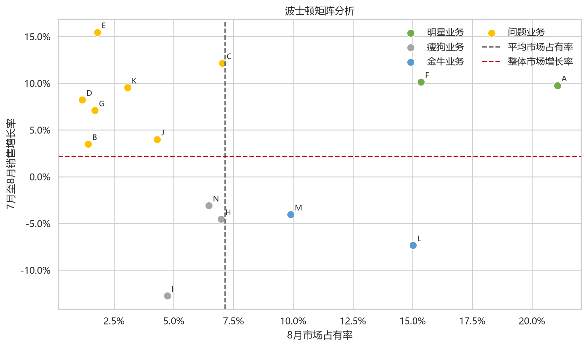
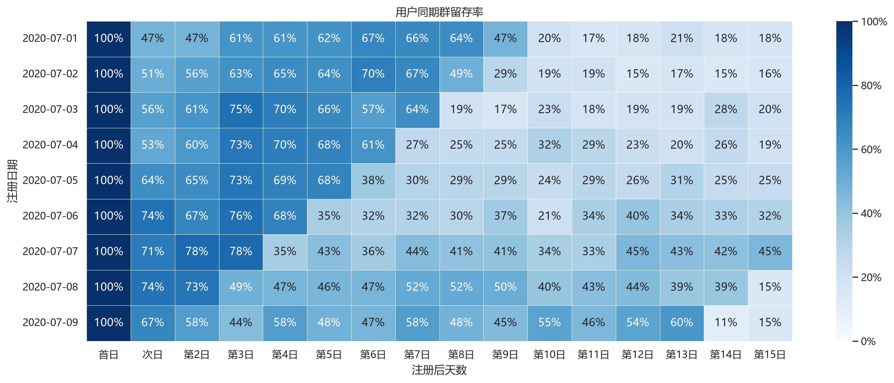
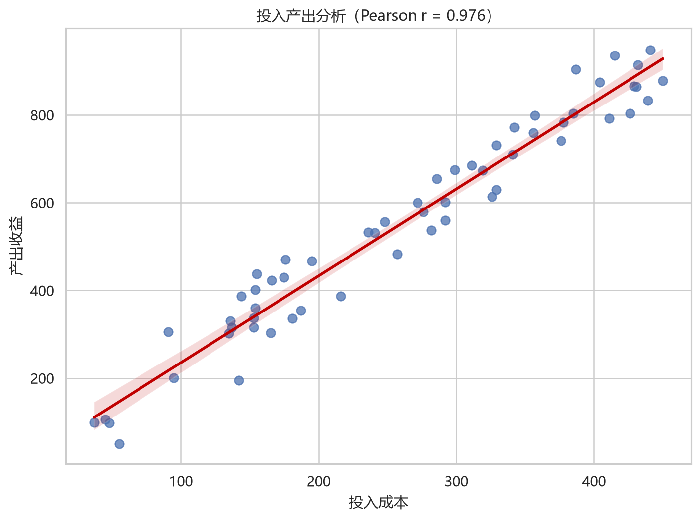

# CDA 第2章商业数据分析图表复现

本项目使用 Python 复现《CDA 一级认证教材：商业数据分析》第2章示例表格中的主要图表。代码使用仓库内的相对路径，不依赖作者电脑的盘符或绝对路径。

## 图表内容

- 波士顿矩阵
- RFM 用户分类与帕累托图
- 用户忠诚度分层
- 同期群留存热力图
- 销售漏斗图
- 相关分析散点图
- 趋势、对比、分布、构成和关系分析图
- 交互式桑基图

## 项目结构

```text
cda-chapter2-data-visualization/
├── CDA第2章图表复现.ipynb
├── CDA第二章图表复现.py
├── requirements.txt
├── data/
│   └── 复现所需的 Excel 数据
└── chapter2_chart_outputs/
    ├── PNG 图片
    └── 交互式桑基图 HTML
```

## 快速开始

```bash
python -m venv .venv
```

Windows PowerShell：

```powershell
.venv\Scripts\Activate.ps1
pip install -r requirements.txt
jupyter lab
```

打开 `CDA第2章图表复现.ipynb`，依次运行所有单元格。图片会保存到 `chapter2_chart_outputs/`。

## 上传到 GitHub

在本项目文件夹中执行：

```bash
git init
git add .
git commit -m "Add CDA chapter 2 data visualization project"
git branch -M main
git remote add origin https://github.com/你的用户名/你的仓库名.git
git push -u origin main
```

## 图表预览

### 波士顿矩阵



### 同期群留存热力图



### 投入产出分析



## 数据说明

`data/` 中的 Excel 文件来自用户提供的课程材料，用于学习与图表复现。如果将仓库设置为公开，请先确认你有权公开分享这些原始课程数据。
